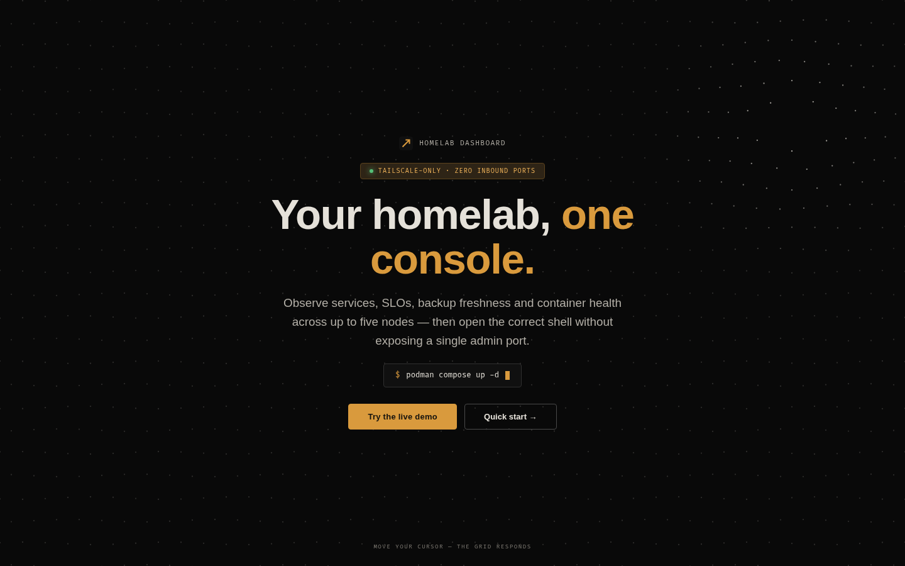

# Landing Page — Design Prototype (dot-wave hero)

> Mẫu thiết kế landing page đã duyệt sơ bộ (2026-08-04).
> Nguồn: `/tmp/dotwave/index3.html` (prototype chạy được, đã verify bằng
> puppeteer: dot đẩy theo cursor, đồng bộ tokens dashboard).
>
> **Trạng thái:** prototype — chưa tích hợp vào `site/` (Task 4).
> Khi chính thức hóa: tách thành `site/index.html` + `site/css/style.css` +
> `site/js/wave.js`, thêm content thật (quickstart, so sánh, footer).

---

## 1. Design Read (theo taste-skill anti-slop)

- **Page kind:** landing (SaaS, developer audience — homelab self-hosters)
- **Vibe:** dark tech, austere technical (đúng tone dashboard), một motion hero duy nhất
- **Dials:** VARIANCE 7 / MOTION 7 / DENSITY 4
- **Anti-default:** KHÔNG gradient tím AI, KHÔNG glassmorphism khắp nơi, KHÔNG 3 card tính năng bằng nhau, KHÔNG Inter + slate-900

## 2. Quyết định thiết kế đã chốt

| Quyết định | Giá trị | Lý do |
|---|---|---|
| Nền | `--bg-deep #090909` | Đồng bộ tokens dashboard |
| Dot | warm-white `#e5e1d9` alpha 0.16–0.95 | Không trắng lạnh `#fff` |
| Tương tác | **Magnetic repel** theo cursor (bán kính 240px) | "Wow" có chủ đích: một interaction duy nhất |
| Sóng ambient | 2px (rất nhẹ) | Nền không đứng yên, không lấn át |
| Accent | `--accent #d99a3d` | Đồng bộ dashboard |
| Font | Inter + JetBrains Mono (mono cho label/chip) | Đồng bộ dashboard |
| Radius | 4px / 6px | Austere technical, không bo tròn generic |
| Terminal line | `$ podman compose up -d` + cursor blink | Chi tiết ops-console đúng DNA |
| Reduced motion | Đứng yên khi `prefers-reduced-motion` | Accessibility |

## 2.5 Screenshots (đã verify — puppeteer, cursor ở 3 vị trí)

> Cursor di chuyển → dot grid đẩy theo (magnetic repel). Ảnh chụp từ prototype
> chạy thật, 1440×900. Không chứa IP/hostname thật — an toàn public.

**Cursor trái (dot đẩy sang trái):**


**Cursor giữa (dot đẩy quanh trung tâm):**


**Cursor trên-phải (dot đẩy lên góc):**



> Trong ảnh tĩnh không thấy được chuyển động — xem GIF/trực tiếp để thấy sóng.
> Prototype gốc: `/tmp/dotwave/index3.html` (hoặc copy code mục 3 ra file HTML).

## 3. Prototype đầy đủ (index3.html — hoạt động)

```html
<!DOCTYPE html>
<html lang="en">
<head>
<meta charset="UTF-8">
<meta name="viewport" content="width=device-width, initial-scale=1.0">
<title>HomeLab Dashboard — Landing</title>
<!-- Đồng bộ 100% với static/css/tokens.css của dashboard -->
<style>
  :root {
    --bg-base: #101010;
    --bg-deep: #090909;
    --bg-surface: #151515;
    --bg-card: #191919;
    --bg-card-hover: #202020;
    --surface-muted: #1d1d1d;
    --surface-selected: #2a2115;
    --border: #303030;
    --border-subtle: #252525;
    --border-hover: #5a482b;
    --border-strong: #4a4a4a;
    --text-primary: #e5e1d9;
    --text-secondary: #b3afa7;
    --text-dim: #7e7a73;
    --text-inverse: #15120d;
    --accent: #d99a3d;
    --accent-hover: #efb35a;
    --accent-muted: #5b421d;
    --accent-soft: #2e2416;
    --green: #55bf78;
    --red: #e15f59;
    --font-sans: Inter, -apple-system, BlinkMacSystemFont, "Segoe UI", sans-serif;
    --font-mono: "JetBrains Mono", "Fira Code", "Cascadia Code", Consolas, monospace;
    --radius-sm: 4px;
    --radius-md: 6px;
    --ease: cubic-bezier(0.2, 0, 0, 1);
    --duration: 160ms;
  }
  * { margin: 0; padding: 0; box-sizing: border-box; }
  html, body { height: 100%; }
  body {
    background: var(--bg-deep);
    color: var(--text-primary);
    font: 14px/1.45 var(--font-sans);
    -webkit-font-smoothing: antialiased;
    overflow: hidden;
    cursor: crosshair;
    color-scheme: dark;
  }
  #wave { position: fixed; inset: 0; width: 100%; height: 100%; z-index: 0; display: block; }

  .content {
    position: relative; z-index: 1; height: 100%;
    display: flex; flex-direction: column;
    align-items: center; justify-content: center; gap: 20px;
    text-align: center; padding: 0 24px; pointer-events: none;
  }
  .brand-mark {
    display: inline-flex; align-items: center; gap: 10px;
    font: 11px/1.2 var(--font-mono); letter-spacing: 0.12em;
    color: var(--text-secondary); text-transform: uppercase;
  }
  .brand-mark svg { width: 22px; height: 22px; }
  .badge {
    display: inline-flex; align-items: center; gap: 8px;
    padding: 6px 14px;
    border: 1px solid var(--accent-muted);
    border-radius: var(--radius-sm);
    color: var(--accent-hover);
    background: var(--accent-soft);
    font: 10px/1.2 var(--font-mono);
    letter-spacing: 0.1em;
    text-transform: uppercase;
  }
  .badge .status-dot { width: 6px; height: 6px; border-radius: 50%; background: var(--green); box-shadow: 0 0 8px var(--green); }
  h1 {
    font-size: clamp(2.4rem, 5.5vw, 4.2rem);
    font-weight: 700; letter-spacing: -0.02em; line-height: 1.06;
    max-width: 760px;
  }
  h1 .accent { color: var(--accent); }
  p.sub {
    font-size: clamp(1rem, 1.6vw, 1.18rem);
    color: var(--text-secondary); max-width: 560px; line-height: 1.6;
  }
  .terminal-line {
    display: inline-flex; align-items: center; gap: 10px;
    padding: 10px 18px;
    border: 1px solid var(--border);
    border-radius: var(--radius-sm);
    background: var(--bg-base);
    font: 12px/1.4 var(--font-mono);
    color: var(--text-dim);
  }
  .terminal-line .prompt { color: var(--accent); }
  .terminal-line .cmd { color: var(--text-primary); }
  .terminal-line .cursor {
    width: 7px; height: 14px; background: var(--accent);
    animation: blink 1.1s step-end infinite;
  }
  @keyframes blink { 50% { opacity: 0; } }
  .row { display: flex; gap: 12px; pointer-events: auto; margin-top: 6px; }
  .cta {
    padding: 12px 30px; border-radius: var(--radius-sm);
    background: var(--accent); color: var(--text-inverse);
    font-weight: 700; font-size: 13px; letter-spacing: 0.02em;
    border: 1px solid var(--accent); cursor: pointer;
    transition: background var(--duration) var(--ease), transform var(--duration) var(--ease), box-shadow var(--duration) var(--ease);
  }
  .cta:hover { background: var(--accent-hover); transform: translateY(-1px); box-shadow: 0 8px 32px rgba(217,154,61,.18); }
  .ghost {
    padding: 12px 30px; border-radius: var(--radius-sm);
    background: transparent; color: var(--text-primary);
    border: 1px solid var(--border-strong); font-weight: 600; font-size: 13px;
    cursor: pointer; transition: border-color var(--duration) var(--ease), background var(--duration) var(--ease), color var(--duration) var(--ease);
  }
  .ghost:hover { border-color: var(--accent-muted); background: var(--accent-soft); color: var(--accent-hover); }
  .hint {
    position: fixed; bottom: 24px; left: 50%; transform: translateX(-50%);
    font: 9px/1.2 var(--font-mono); letter-spacing: 0.16em;
    color: var(--text-dim); text-transform: uppercase; z-index: 1; pointer-events: none;
  }
</style>
</head>
<body>
<canvas id="wave"></canvas>
<div class="content">
  <span class="brand-mark">
    <svg viewBox="0 0 32 32" fill="none"><rect width="32" height="32" rx="6" fill="#101010"/><path d="M8 24 24 8M15 8h9v9" stroke="#d99a3d" stroke-width="3" fill="none"/></svg>
    HOMELAB DASHBOARD
  </span>
  <span class="badge"><span class="status-dot"></span> Tailscale-only · Zero inbound ports</span>
  <h1>Your homelab, <span class="accent">one console.</span></h1>
  <p class="sub">Observe services, SLOs, backup freshness and container health across up to five nodes — then open the correct shell without exposing a single admin port.</p>
  <div class="terminal-line" aria-hidden="true">
    <span class="prompt">$</span>
    <span class="cmd">podman compose up -d</span>
    <span class="cursor"></span>
  </div>
  <div class="row">
    <button class="cta">Try the live demo</button>
    <button class="ghost">Quick start →</button>
  </div>
</div>
<div class="hint">Move your cursor — the grid responds</div>

<script>
(() => {
  const canvas = document.getElementById('wave');
  const ctx = canvas.getContext('2d');
  let W, H, dots = [], running = true;

  const SPACING = 36;
  const MOUSE_RADIUS = 240;
  const MOUSE_POWER = 30;
  const AMBIENT = 2;
  const DPR = Math.min(window.devicePixelRatio || 1, 2);

  const mouse = { x: -9999, y: -9999, vx: 0, vy: 0, px: -9999, py: -9999 };

  function resize() {
    W = canvas.width = innerWidth * DPR;
    H = canvas.height = innerHeight * DPR;
    canvas.style.width = innerWidth + 'px';
    canvas.style.height = innerHeight + 'px';
    build();
  }
  function build() {
    dots = [];
    const cols = Math.ceil(W / SPACING / DPR) + 2;
    const rows = Math.ceil(H / SPACING / DPR) + 2;
    for (let r = 0; r < rows; r++) {
      for (let c = 0; c < cols; c++) {
        dots.push({
          bx: c * SPACING * DPR + (r % 2 ? SPACING / 2 * DPR : 0),
          by: r * SPACING * DPR,
          x: 0, y: 0,
          phase: (c * 0.31 + r * 0.47) * Math.PI,
        });
      }
    }
  }

  let t = 0;
  function frame() {
    if (!running) return;
    ctx.clearRect(0, 0, W, H);
    t += 0.016;
    mouse.vx = mouse.x - mouse.px;
    mouse.vy = mouse.y - mouse.py;
    mouse.px = mouse.x; mouse.py = mouse.y;

    for (const d of dots) {
      const amb = Math.sin(d.phase + t * 1.6) * AMBIENT * DPR;
      const dx = d.bx - mouse.x, dy = d.by - mouse.y;
      const dist = Math.hypot(dx, dy);
      let pushX = 0, pushY = 0, prox = 0;
      if (dist < MOUSE_RADIUS * DPR && dist > 0.01) {
        const falloff = 1 - dist / (MOUSE_RADIUS * DPR);
        const power = falloff * falloff * MOUSE_POWER * DPR;
        const speedBoost = 1 + Math.min(Math.hypot(mouse.vx, mouse.vy) / 8, 2.2);
        pushX = (dx / dist) * power * speedBoost;
        pushY = (dy / dist) * power * speedBoost;
        pushX += (mouse.vx / 30) * falloff * 14 * DPR;
        pushY += (mouse.vy / 30) * falloff * 14 * DPR;
        prox = falloff;
      }
      d.x = d.bx + pushX;
      d.y = d.by + amb + pushY;
      // warm white #e5e1d9, alpha theo proximity (sáng hơn gần chuột)
      const alpha = 0.16 + prox * 0.62;
      ctx.beginPath();
      ctx.arc(d.x, d.y, 1.15 * DPR, 0, Math.PI * 2);
      ctx.fillStyle = `rgba(229, 225, 217, ${Math.max(0.08, Math.min(alpha, 0.95))})`;
      ctx.fill();
    }
    requestAnimationFrame(frame);
  }

  addEventListener('pointermove', e => { mouse.x = e.clientX * DPR; mouse.y = e.clientY * DPR; });
  addEventListener('pointerleave', () => { mouse.x = mouse.y = -9999; });
  resize();
  addEventListener('resize', resize);
  frame();

  const mq = matchMedia('(prefers-reduced-motion: reduce)');
  mq.addEventListener('change', e => { running = !e.matches; if (running) frame(); else ctx.clearRect(0,0,W,H); });
  if (mq.matches) { running = false; ctx.clearRect(0,0,W,H); }
})();
</script>
</body>
</html>
```

## 4. Cách xem prototype

Prototype gốc chạy được nằm ở `/tmp/dotwave/index3.html` (có thể đã mất sau reboot — nếu cần xem lại, copy code ở mục 3 ra file HTML rồi mở browser).

## 5. Khi chính thức hóa (Task 4)

- [ ] Tách JS dot-wave → `site/js/wave.js`
- [ ] Tách CSS → `site/css/style.css` (giữ `:root` tokens khớp `static/css/tokens.css`)
- [ ] Thêm content thật: quickstart 3 bước, bảng so sánh, footer, link demo
- [ ] `overflow: hidden` hiện tại chỉ hợp hero full-screen — landing thật cần scroll → điều chỉnh layout
- [ ] Verify bằng checklist mục 9 trong `landing-page-github-pages-guide.md`
