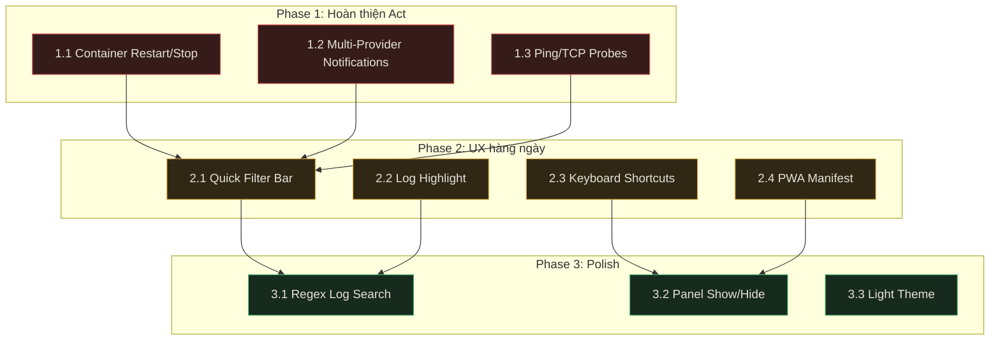

# Kế hoạch Tổng thể: Nâng cấp HomeLab Dashboard

> Tổng hợp toàn bộ nghiên cứu từ 2026-08-02 đến 2026-08-04.
> So sánh với 16 sản phẩm: Homer, Homepage, Homarr, Dashy, Portainer, Cockpit,
> Beszel, Uptime Kuma, Netdata, Grafana, Dozzle, CasaOS, Glances, Yacht,
> Organizr, Heimdall, Flame.
>
> Chỉ lên kế hoạch, chưa triển khai.

---

## Phần A: Những gì đã làm tốt — Giữ nguyên

Dashboard hiện tại có **7 tính năng UNIQUE** (không sản phẩm nào trên thị trường có)
và **5 tính năng RARE** (chỉ 1–2 đối thủ có tương tự). Đây là lợi thế cạnh tranh
cốt lõi, **không được thay đổi hoặc pha loãng**:

| # | Tính năng UNIQUE | Lý do giữ |
|---|---|---|
| 1 | 6-in-1 Observe + Act (metrics + logs + shell + probes) | Không ai kết hợp được toàn bộ vào 1 UI |
| 2 | Outbound-only agents qua Tailscale WSS | Zero inbound port = an toàn hơn mọi đối thủ |
| 3 | Tailscale identity = sole auth (không fallback) | Đơn giản hơn mọi hệ thống auth khác |
| 4 | 3-tier SQLite rollup (10s→1m→15m, 90d) | Không cần Prometheus/InfluxDB |
| 5 | SLO error budgets tích hợp sẵn | Concept enterprise SRE, không homelab dashboard nào có |
| 6 | Demo mode mô phỏng edge-cases | Không ai có demo thực tế như vậy |
| 7 | PARTIAL snapshot degradation | Xử lý dữ liệu không đầy đủ tốt hơn mọi đối thủ |

| # | Tính năng RARE | Đối thủ gần nhất |
|---|---|---|
| 8 | Backup freshness monitoring | Uptime Kuma (heartbeat, khác mechanism) |
| 9 | Operations timeline | Grafana (annotations) |
| 10 | Service topology map | Grafana (Node Graph plugin) |
| 11 | Host Bash via Unix socket agent | Cockpit (cockpit-bridge) |
| 12 | Config export/import + If-Match revision guard | Không ai |

---

## Phần B: Những gì nên học hỏi từ đối thủ

### Từ Portainer & Cockpit — "Act" phải thực sự hành động được

Dashboard tự nhận là "observe → understand → act" nhưng phần "act" chỉ có
shell và logs. **Portainer cho phép restart/stop container bằng 1 click.**
Cockpit cho phép quản lý systemd services. Đây là hành động phổ biến nhất
của homelab operator — phải có.

**Bài học**: Thêm container restart/stop (cả local và remote node).

---

### Từ Uptime Kuma — Thông báo phải đến được operator

Uptime Kuma hỗ trợ **90+ notification providers** (Telegram, Discord, Slack,
Email, Webhook, Gotify, Pushover...). Dashboard chỉ có ntfy — phần lớn
homelab operator không dùng ntfy.

**Bài học**: Xây dựng hệ thống notification provider mở rộng được.

---

### Từ Uptime Kuma — Giám sát không chỉ HTTP

Uptime Kuma probe được DNS, TCP, Ping, MQTT, gRPC, game servers...
Dashboard chỉ có HTTP probe — không giám sát được Pi-hole (DNS),
PostgreSQL (TCP), Minecraft (TCP), Redis (TCP).

**Bài học**: Thêm Ping/TCP probe types.

---

### Từ Dozzle — Log phải dễ đọc

Dozzle tô màu log theo severity (ERROR=đỏ, WARN=vàng, DEBUG=xám),
hỗ trợ regex search, multi-container log merge.
Dashboard hiển thị log thô hoàn toàn.

**Bài học**: Log level highlighting + regex search.

---

### Từ Portainer & Cockpit — Danh sách dài phải lọc được

Portainer có search bar, Cockpit có filter. Homelab 20-30 containers
là bình thường. Phải cuộn tay tìm container = mất thời gian.

**Bài học**: Quick filter bar cho Services & Containers.

---

### Từ Homepage & Homarr — Mobile phải "install" được

Homepage và Homarr hỗ trợ PWA — operator cài lên home screen điện thoại
như app native. Chỉ cần 1 file `manifest.json` + 1 icon.

**Bài học**: Thêm PWA manifest (effort rất thấp, giá trị rất cao).

---

### Từ Cockpit & VS Code — Operator cần phím tắt

Operator workbench chuyên nghiệp cần thao tác hoàn toàn bằng bàn phím.
Cockpit có phím tắt. Grafana có phím tắt. k9s (Kubernetes TUI) có phím tắt.

**Bài học**: Keyboard shortcuts system.

---

### Từ Homer & Homarr — Operator muốn tùy chỉnh workspace

Homer cho phép tổ chức layout qua YAML. Homarr cho phép kéo thả widget.
Dashboard có 7 workspace cố định, không ẩn/hiện hay sắp xếp lại được.

**Bài học**: Cho phép ẩn/hiện từng panel + sắp xếp lại thứ tự workspace
(không cần full drag-and-drop — giữ đúng triết lý operator workbench).

---

## Phần C: Tổng hợp Gap — Còn thiếu gì

### Thiếu nghiêm trọng (ảnh hưởng vòng lặp vận hành cốt lõi)

| # | Tính năng thiếu | Ai có | Impact |
|---|---|---|---|
| 1 | Container restart/stop | Portainer, Cockpit, CasaOS | USP "act" chưa hoàn chỉnh |
| 2 | Multi-provider notifications | Uptime Kuma (90+), Grafana | 90% operator không dùng ntfy |
| 3 | Ping/TCP probe types | Uptime Kuma | Không giám sát được DNS/DB/game |

### Thiếu đáng kể (ảnh hưởng trải nghiệm hàng ngày)

| # | Tính năng thiếu | Ai có | Impact |
|---|---|---|---|
| 4 | Quick filter/search | Portainer, Cockpit, Dozzle | 20+ items → cuộn tay |
| 5 | Log level highlighting | Dozzle | Khó phát hiện lỗi trong log thô |
| 6 | Keyboard shortcuts | Cockpit, Grafana | Chậm thao tác |
| 7 | PWA manifest | Homepage, Homarr | Không "install" trên mobile |

### Thiếu nhưng không khẩn cấp

| # | Tính năng thiếu | Ai có | Ghi chú |
|---|---|---|---|
| 8 | Regex log search | Dozzle | Substring match đủ cho hầu hết |
| 9 | Panel show/hide + reorder | Homer, Homarr | Tùy chỉnh workspace |
| 10 | Dark/Light theme toggle | Beszel, Homarr, Uptime Kuma | Dark-only vẫn chấp nhận được |
| 11 | Command palette (Ctrl+K) | VS Code, GitHub | Hay nhưng không ai kỳ vọng |
| 12 | Per-container resource history | Beszel, Netdata | System-level đủ cho troubleshoot |

### Ngoài scope (không nên làm)

| # | Tính năng | Lý do loại |
|---|---|---|
| 13 | Drag-and-drop layout | Biến thành Homarr, vượt triết lý workbench |
| 14 | Docker Compose/Stack management | Biến thành Portainer-lite |
| 15 | OIDC/LDAP auth | Tailscale identity đủ cho homelab |
| 16 | AI anomaly detection | Cần ML pipeline, vượt scope Go-only |
| 17 | Public status page | Feature riêng, khác scope |
| 18 | Service auto-discovery | Phức tạp, chưa cần |
| 19 | Container image pull/update | Rủi ro cao, dùng CLI/Portainer |

---

## Phần D: Roadmap triển khai

### Phase 1 — Hoàn thiện vòng lặp "Act" (ưu tiên cao nhất)

```
┌─────────────────────────────────────────────────────┐
│  1.1  Container Restart / Stop                      │
│       • POST /api/v1/containers/:id/restart|stop    │
│       • Admin-only, CSRF, audit logged              │
│       • Hỗ trợ local + remote node (qua WSS)       │
│       • Confirmation dialog trước khi thực hiện     │
│       • Container protected → không cho phép        │
│       Effort: CAO  │  Backend + Frontend + Agent    │
├─────────────────────────────────────────────────────┤
│  1.2  Multi-Provider Notification System            │
│       • Refactor alerts/ thành provider interface   │
│       • Providers theo thứ tự:                      │
│         ① ntfy (giữ nguyên, refactor thành iface)   │
│         ② Webhook (generic HTTP + HMAC signing)     │
│         ③ Telegram (Bot API)                        │
│         ④ Discord (Webhook URL)                     │
│         ⑤ Slack (Incoming Webhook)                  │
│         ⑥ Email (SMTP)                              │
│         ⑦ Gotify, Pushover                          │
│       • Mỗi rule chọn gửi đến provider nào         │
│       Effort: CAO  │  Backend refactor + UI config  │
├─────────────────────────────────────────────────────┤
│  1.3  Ping / TCP Probe Types                        │
│       • Mở rộng probe URL scheme:                   │
│         tcp://host:port, ping://host                │
│       • Service form cho chọn probe type            │
│       Effort: TRUNG BÌNH  │  Backend + UI form      │
└─────────────────────────────────────────────────────┘
```

### Phase 2 — Nâng cao trải nghiệm vận hành hàng ngày

```
┌─────────────────────────────────────────────────────┐
│  2.1  Quick Filter Bar                              │
│       • Filter input cho Services + Containers      │
│       • Instant client-side filter (name, state)    │
│       • Counter: "Showing X / Y"                    │
│       Effort: THẤP  │  Frontend only               │
├─────────────────────────────────────────────────────┤
│  2.2  Log Level Highlighting                        │
│       • ERROR/FATAL → var(--red)                    │
│       • WARN → var(--yellow)                        │
│       • Chỉ log viewer read-only                    │
│       Effort: THẤP  │  Frontend only               │
├─────────────────────────────────────────────────────┤
│  2.3  Keyboard Shortcuts System                     │
│       • ? = modal, g+o/s/c/h/a/t = workspace       │
│       • / = focus filter, Ctrl+~ = terminal         │
│       • Suppress khi đang gõ input/terminal         │
│       Effort: THẤP  │  Frontend only               │
├─────────────────────────────────────────────────────┤
│  2.4  PWA Manifest                                  │
│       • manifest.json + icon 192x192 + 512x512      │
│       • display: standalone, theme: #101010         │
│       • Không cần Service Worker                    │
│       Effort: RẤT THẤP  │  1 file JSON + icons     │
└─────────────────────────────────────────────────────┘
```

### Phase 3 — Polish & tiện ích bổ sung

```
┌─────────────────────────────────────────────────────┐
│  3.1  Regex Log Search + Match Navigation           │
│       • Toggle /.*/  bên cạnh log search            │
│       • Match counter: "Match X of Y"               │
│       • Enter/Shift+Enter điều hướng                │
│       Effort: THẤP  │  Frontend only               │
├─────────────────────────────────────────────────────┤
│  3.2  Panel Show/Hide + Workspace Reorder           │
│       • Cho ẩn/hiện panel trong Settings             │
│       • Sắp xếp lại sidebar workspace              │
│       • Lưu vào preferences (SQLite)                │
│       Effort: TRUNG BÌNH  │  Frontend + API         │
├─────────────────────────────────────────────────────┤
│  3.3  Dark / Light Theme Toggle                     │
│       • Light palette trong tokens.css              │
│       • Toggle button trên header                   │
│       • Lưu preference                              │
│       Effort: TRUNG BÌNH  │  CSS + JS              │
└─────────────────────────────────────────────────────┘
```

### Sơ đồ phụ thuộc



---

## Phần E: Nguyên tắc khi triển khai

1. **Không thêm dependency**: Go stdlib + vanilla JS/CSS. Không Node.js/npm/CDN.
2. **Tuân thủ DESIGN.md**: Graphite/amber, không gradient/glow/emoji.
3. **Backward compatible**: Không phá API hiện tại hoặc browser test suite.
4. **Admin-gated mutations**: Mọi hành động thay đổi = admin-only + CSRF + audit.
5. **Graceful degradation**: Feature mới không lỗi nếu backend cũ chưa hỗ trợ.
6. **Responsive**: 320px, 375px, 414px, 768px, desktop.
7. **Accessibility**: Touch target ≥ 44×44px, aria-label, keyboard navigable.

## Phần F: Verification khi triển khai

```bash
go mod verify
go vet ./...
go test ./... -count=1 -timeout=180s
go test -race ./... -count=1 -timeout=240s
go test -tags=browser ./tests/browser -count=1 -timeout=180s -v
podman build -t homelab-dashboard:verify .
gofmt -l .
git diff --check
```

---

## Tổng kết 1 câu

> **HomeLab Dashboard đã có 7 tính năng không ai có, nhưng đang thiếu 3 thứ
> mà mọi đối thủ đều có: container lifecycle actions, multi-channel notifications,
> và non-HTTP probes. Bổ sung 3 thứ này + polish UX (filter, log highlight,
> shortcuts, PWA) sẽ đưa dashboard từ 9/10 tính năng lên gần hoàn chỉnh
> cho homelab cá nhân.**
